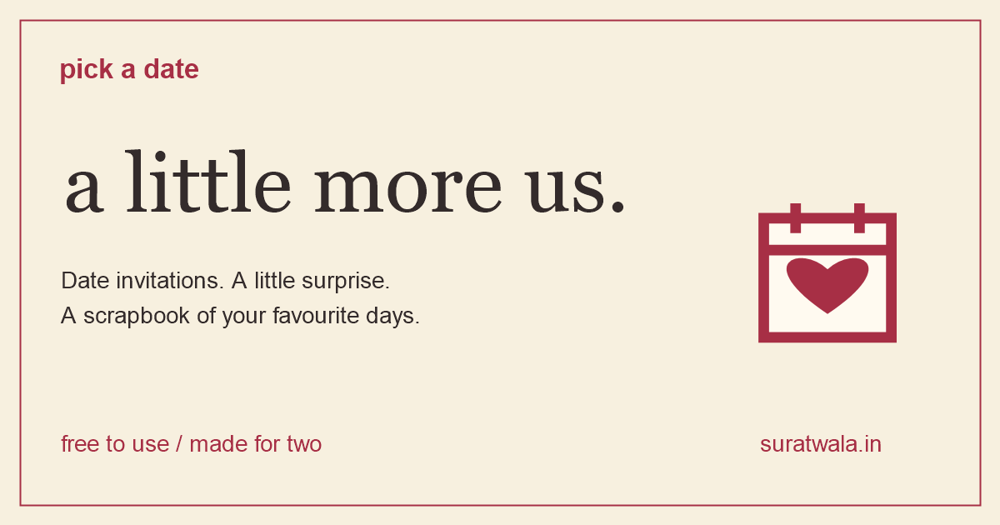

# Pick a Date

A free date planner for couples. Send a little invitation, leave the indecision to roulette, and keep the good bits in a photo scrapbook.

[Open Pick a Date](https://suratwala.in/) | [Create your space](https://suratwala.in/tool) | [Help and privacy](https://suratwala.in/help)



## Made for two

- Your own couple address, such as `ourstory.suratwala.in`, with availability checks and reserved-name protection.
- Both names, a cover photo, a welcome note and cherry, sage or rose themes.
- Date invitations with activities, vibes, rules and a surprise roulette.
- Partner replies to accept, suggest a change or request another day.
- Owner approval of suggestions, followed by an updated ticket and shared countdown.
- Downloadable PNG date tickets with a preview and sharing where supported.
- A scrapbook with up to 50 active memories, photos, ratings and one-line notes.
- Private scrapbook export, recoverable trash and restoration for 30 days.

The tool is free to use.

## What is public?

A couple address shows names, the cover photo, the welcome message and the latest invitation. Anyone who knows the address can view and reply to that invitation. Account details and scrapbook memories require the owner's sign-in.

Couple pages, invitation pages and account screens carry search-indexing exclusions. These directives do not make shared links private. Keep downloaded scrapbook exports somewhere private too.

Photos can be JPG, PNG or WebP, up to 5 MB before browser compression. HEIC must be converted first. Save a separate copy of memories that matter to you.

## Run locally

Use Node.js 24 or newer. The application itself has no npm runtime dependencies.

```sh
npm start
```

Open [http://127.0.0.1:4174](http://127.0.0.1:4174) for the landing page and browser-local preview, or [http://127.0.0.1:4174/tool](http://127.0.0.1:4174/tool) for the account-backed app.

The local server uses SQLite under `data/`, excluded from Git. Local binding defaults to `127.0.0.1`. Optional settings are `PORT`, `HOST`, `PUBLIC_ORIGIN` and `PICKADATE_DB`. The browser-local preview is separate from saved account data.

## How it is built

| Part | Implementation |
| --- | --- |
| Interface | HTML, CSS and browser JavaScript |
| Local API | Node.js HTTP server and SQLite |
| Hosted API | Cloudflare Worker and D1 |
| Couple addresses | Wildcard DNS and tenant routing |
| Accounts | Salted scrypt password hashes, hashed session tokens and HttpOnly cookies |
| Invitations | Revision checks, owner approval, IANA timezones and a canonical UTC start time |
| Photos | Browser compression and server-side format and size validation |
| Discovery | Canonical URLs, sitemap, structured data and branded sharing previews |

`server.mjs` is the local API source. `prepare-cloudflare.py` generates `worker.mjs`, `schema.sql` and the `public/` asset copies. Regenerate after changing API source or public assets:

```sh
python prepare-cloudflare.py
```

Production runs at **suratwala.in**. The Cloudflare build currently deploys **`revamp/couple-spaces`** using `npx wrangler deploy`; `main` also contains the current app for the repository's default view. Changes made only on `main` do not automatically update that production deployment.

Apply database changes deliberately after reviewing their effect on existing records. Never overwrite the live database as part of a test.

## Checks

```sh
npm run check
npm test
```

Browser checks require the development dependencies and Playwright browsers:

```sh
npm install
npx playwright install
npm run test:devices
```

The browser suite covers desktop Chromium, Android Chrome emulation and iPhone Safari emulation. It checks narrow layouts, separate owner and partner sessions, agreement updates, photo limits and PNG ticket downloads. Other checks cover ownership, recovery tokens, memory privacy, concurrent limits, SEO routing and encrypted backup restoration using synthetic data.

Emulation does not replace real-phone checks of Photos, file pickers and native sharing. See [LAUNCH-CHECKS.md](LAUNCH-CHECKS.md) and the [phone checklist](https://suratwala.in/help#phone-check).

## Remaining launch setup

- **Email delivery:** Verification and password-reset flows are implemented. Live delivery still needs a verified sender and `MAIL_FROM` plus `RESEND_API_KEY`, or a supported email binding. Never commit credentials.
- **External backups:** The encrypted workflow is installed on `main`, but remains paused until credentials, a successful manual backup and an isolated restore check are complete. See [BACKUPS.md](BACKUPS.md) before enabling `BACKUPS_ENABLED`.
- **Physical phones:** Real Android and iPhone testing remains pending.
- **Search Console:** Domain verification and sitemap submission remain pending. The public sitemap is [suratwala.in/sitemap.xml](https://suratwala.in/sitemap.xml).

## Help and bug reports

Read the [help page](https://suratwala.in/help) or [report a bug](https://github.com/Faddzi/pickadate/issues/new).

GitHub reports are public. Include your browser, device and reproduction steps, but leave out personal names, email addresses, couple addresses, invitation or recovery links, photos and passwords.
